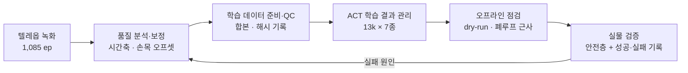

# OMX Physical AI Engineering Portfolio

**로봇 팔 모방학습(ACT)의 데이터 수집부터 품질 분석, 학습, 실물 검증까지**

PURPLE-SY · 2026-10 ~ 2026-11 · OpenMANIPULATOR-X(OMX) 팀 프로젝트 중 본인 담당 업무

---

## 한눈에 보기

| 텔레옵 원본 | 프레임 | ACT 학습 | 실물 검증 | 원본 무결성 |
|:---:|:---:|:---:|:---:|:---:|
| **1,085** 에피소드 | **706,919** | 13,000-step × **7종** | **3건** | SHA-256 **1,081** 파일 일치 |

- **원본 범위:** 85개 폴더, 2026-10-29 ~ 11-25, 로컬과 Hugging Face 사본은 한 번만 셈. 진단 녹화와 파생 데이터는 합계에서 제외.
- **SHA-256 대조:** 기존 78개 데이터셋 979파일, 신규 업로드 10개 102파일.
- **수치 근거:** 모든 수치는 원본 `meta/info.json`, 실행 로그, 탑뷰 영상에서 다시 집계했다. 확인하지 못한 값은 문서에 **미확인**으로 표시했다.

---

## 프로젝트 소개

OpenMANIPULATOR-X(OMX) 로봇 팔이 컨베이어의 컨테이너를 집어 트레이의 층(F01~F03)·자리(S01~S06)·분류 장소(EX)에 놓도록 **ACT 모방학습**으로 가르치는 팀 프로젝트다. 이 저장소는 그중 **내가 직접 수행한 엔지니어링**을 정리한다.

**기술 스택 (실제로 사용한 것만)**
- **데이터:** LeRobot v3 데이터셋, parquet·AV1 영상, Hugging Face Hub(업로드·SHA-256 대조)
- **로봇·센서:** Dynamixel XL430/XL330 + OpenRB-150(레지스터 읽기 점검), RealSense D435, USB 카메라(OpenCV)
- **학습·추론:** ACT 정책. 학습은 별도 GPU PC, 노트북에서는 CPU 추론·오프라인 dry-run
- **도구:** Python, pandas/numpy, PyAV, ffmpeg, Git/GitHub CLI, Ubuntu 24.04
- **AI 코딩 도구:** Claude Code, Codex. 분석 스크립트는 지시·검토 방식으로 작성했고, 출처를 [scripts/README.md](scripts/README.md)에 명시함

---

## 핵심 성과

### 1. 대규모 텔레옵 데이터 수집과 관리
- 왼팔·오른팔·앞팔·양팔로 **85개 폴더, 1,085 에피소드, 706,919 프레임** 녹화
- 날짜·팔·층·위치·카메라별 인벤토리를 만들고 HF 원본과 파일 단위 SHA-256 대조
  - 기존 78개는 전부 일치
  - 누락분 10개를 추가하고 102/102 일치
- → [데이터 수집 이력](docs/data-collection-timeline.md) · [데이터셋 인벤토리](docs/dataset-inventory.csv)

### 2. 데이터 품질 오류를 찾아 정량 보정
- **시간축 압축 (11/14, 158 ep):** 표기 30 Hz ↔ 실제 13~15 Hz. 실제 38.26 s가 16.0 s로 저장됨. 원본 보존 원칙으로 분석
- **손목 action 오프셋 (Left F02, 60 ep):** 51.4~55.3 units 어긋남을 찾아 보정
  - 결과: \|a−s\| 중앙값 **145 → 0.3**, 경계 점프 **49 → 0**
  - 이 데이터로 학습한 기존 모델은 dry-run 게이트 FAIL 7개 → 실물 실행 금지 → 보정 데이터로 재학습
- **0.5초 정지가 1프레임으로 압축:** 시간 왜곡 3~5%
- → [데이터 품질 분석](docs/data-quality-analysis.md) · [손목 오프셋 분석](docs/wrist-fix-analysis.md)

### 3. ACT 13,000-step 학습 이력 관리
- 팔(A/B) × 층(F01/F02/F03/EX) **7종**, 189파일 / 8.05 GB
- Best val loss **0.2122 ~ 0.3256**
- 학습 loss와 실물 성공률은 구분해서 기록
- → [ACT 학습 이력](docs/act-training-history.md)

### 4. 실물 로봇 검증 3건 — 성공과 실패를 그대로

| 검증 | 방식 | 결과 |
|---|---|---|
| [B팔 F01 S03](docs/physical-validation-F01-S03.md) | ACT 정책 | 15회 중 집기 10, 놓기 4, 완전 성공 1 |
| [B팔 F02 S01](docs/physical-validation-F02-S01.md) | 녹화 데이터 리플레이 (정책 아님) | ep7 635 frames, 85.5 s, 1회 성공 |
| [B팔 F02 S05](docs/physical-validation-F02-S05.md) | ACT 정책, 보정 없는 설정 7회 | 깨끗한 성공 4, 2층 충돌 3 |

**안전층:** 실행 전 읽기 전용 점검, 학습 범위 ±8 관절 제한, 2단계 park 복귀, 고정 PID 적용을 로그로 확인. 위험한 시도는 즉시 중단하고 원복했다.

→ [성공·실패 원인 분석](docs/success-failure-analysis.md)

### 5. 하드웨어·통신 문제 분석
- **정책 실행 경로의 PID 게인 누락:** 실행 중 shoulder_lift가 P4000/D600(라이브러리 기본값)으로 동작하던 것을 찾아 수정함
- **sync-read 0.5초 멈춤:** Return_Delay_Time 50으로 약 1/6 감소
- **ID13 elbow 과부하, PWM 한도가 낮아진 상태로 재연결:** 사실과 추정을 나눠 기록, 원인 미해결로 표시
- → [하드웨어 디버깅 기록](docs/hardware-debugging.md)

---

## 개인 기여도 — 팀 성과와 내 업무의 구분

| 구분 | 내용 | 근거 |
|---|---|---|
| **팀 전체** | OMX 앱(녹화·텔레옵·정책 실행) 본체 개발, 학습 GPU 환경 | 팀 저장소 커밋 대다수는 다른 팀원 작성 |
| **내 업무 — 데이터** | 텔레옵 녹화 운영, 인벤토리·HF 정리, SHA-256 검증 | 녹화 원본 85개 폴더, HF 업로드·대조 기록 |
| **내 업무 — 품질** | 시간축·손목 오프셋·정지 압축 분석, 보정본 검증 | 분석 보고서와 검증 json, [scripts/](scripts/README.md) |
| **내 업무 — 코드** | 팀 저장소 본인 커밋 15건 중 기능·수정 커밋 10건: 포트 자동 감지, 상대 추종 수정, 녹화 설정 이식, 손목 action 감시·안전 중단, Return_Delay_Time, 오프라인 Auto Homing(미병합). 나머지 5건은 작업 보존용(stash·wip·병합) | 본인 커밋 기록. 팀 코드라 공개본에는 미포함 |
| **내 업무 — 검증** | 실물 실행 전 점검, 실물 검증 3건 수행·기록 | 실행 로그, 탑뷰 영상, 결과표 |
| **협업 이력** | 팀 플랫폼 저장소 이슈 2건 담당(역할·인수인계) | GitHub 이슈 |

자세한 내용: [엔지니어링 기여](docs/engineering-contribution.md) · [면접 요약](docs/interview-summary.md)

---

## 날짜별 수집량 (텔레옵 원본)

| 날짜 | Episodes | Frames | 팔 |
|---|---:|---:|---|
| 10-29 ~ 10-31 | 71 | 68,336 | Left |
| 11-02 ~ 11-04 | 108 | 59,390 | Left, Front |
| 11-07 | 175 | 84,691 | Left |
| 11-09 ~ 11-11 | 145 | 61,951 | Left |
| 11-14 | 158 | 72,660 | Left |
| 11-17 ~ 11-19 | 92 | 49,090 | Right, Both |
| 11-21 | 180 | 150,298 | Left, Right |
| 11-22 | 37 | 72,333 | Left, Right |
| 11-23 | 90 | 67,211 | Left |
| 11-24 ~ 11-25 | 29 | 20,959 | Left, Right |
| **합계** | **1,085** | **706,919** | |

날짜별·자리별 세부 표: [data-collection-timeline.md](docs/data-collection-timeline.md)

---

## 문서 지도

| 분야 | 문서 |
|---|---|
| 데이터 수집·관리 | [data-collection-timeline.md](docs/data-collection-timeline.md) · [dataset-inventory.csv](docs/dataset-inventory.csv) |
| 데이터 품질 | [data-quality-analysis.md](docs/data-quality-analysis.md) · [wrist-fix-analysis.md](docs/wrist-fix-analysis.md) |
| ACT 모방학습 | [act-training-history.md](docs/act-training-history.md) |
| 하드웨어·통신 | [hardware-debugging.md](docs/hardware-debugging.md) |
| 실물 검증 | [F01-S03](docs/physical-validation-F01-S03.md) · [F02-S01](docs/physical-validation-F02-S01.md) · [F02-S05](docs/physical-validation-F02-S05.md) |
| 성공·실패 분석 | [success-failure-analysis.md](docs/success-failure-analysis.md) |
| 역할·요약 | [engineering-contribution.md](docs/engineering-contribution.md) · [interview-summary.md](docs/interview-summary.md) |
| 증빙·공개 범위 | [evidence-and-huggingface-links.md](docs/evidence-and-huggingface-links.md) |
| 코드 | [scripts/](scripts/README.md) — 실행 흔적이 확인된 분석·점검 스크립트 |

---

## 공개 범위
- 이 저장소는 공개 저장소다. 공개 전에 팀 내부 정보, 다른 팀원의 코드, 인증정보, 개인정보, 장치 식별자를 검사했다.
- 원본 녹화·모델·실물 검증 자료는 Hugging Face(Purple-SY)에 있다. 팀 공개 권한이 확인되기 전까지 **직접 링크는 게시하지 않고**, 저장소 이름·통계·SHA-256 결과만 공개한다.
- 미해결 문제와 미확인 수치를 숨기지 않고 각 문서에 기록했다.
