

# OMX Physical AI Engineering Portfolio

**로봇 팔 모방학습(ACT)의 데이터 수집부터 품질 분석, 학습, 실물 검증까지**

### PURPLE-SY (김승용)

**Robotics · Physical AI** 
Robot Control · Imitation Learning · Real-world Validation

2026-10 ~ 2026-11 · OpenMANIPULATOR-X(OMX) 팀 프로젝트 중 본인 담당 업무

<a href="assets/media/videos/01_B-F01-S03_ACT_success_20261126-2348.mp4">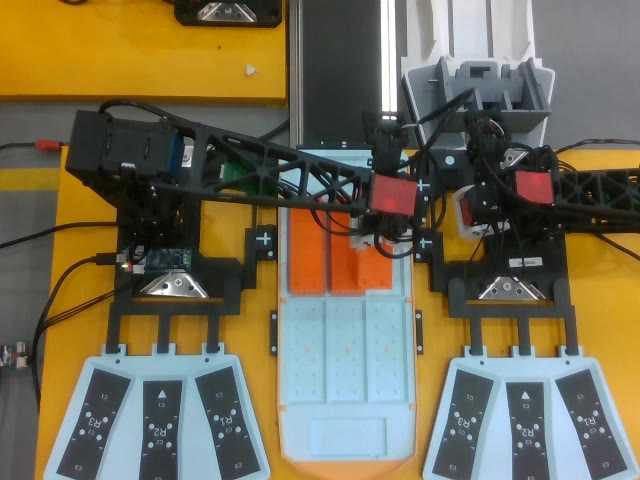</a>
<a href="assets/media/videos/05_B-F02-S05_ACT_success_20261127-0036.mp4">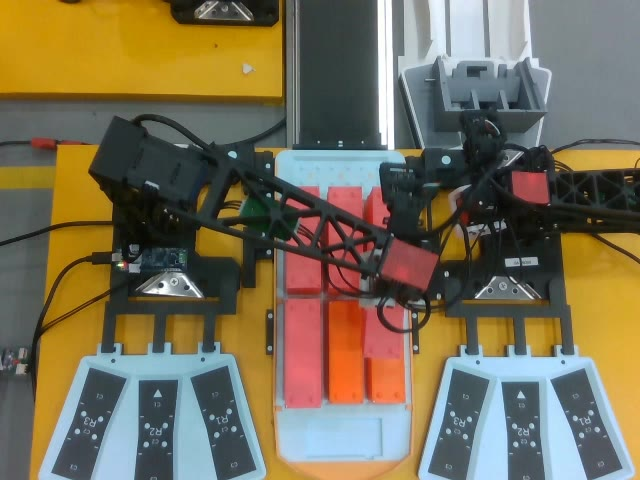</a>
<a href="assets/media/videos/09_B-F01-S03_REPLAY_success_20261128-0254.mp4">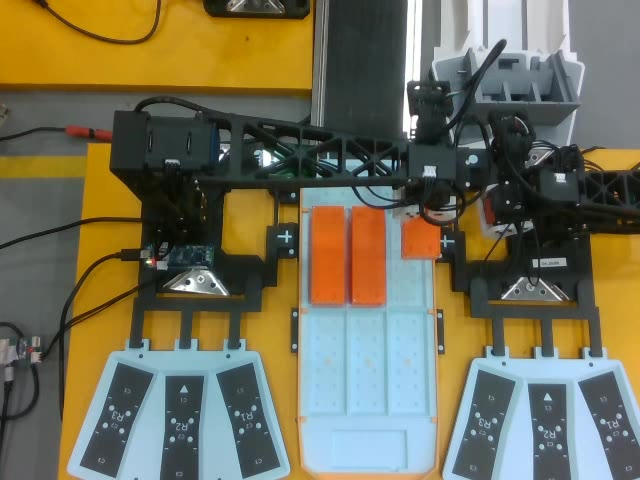</a>

▶ 썸네일을 누르면 영상이 재생됩니다 · 왼쪽부터 <b>ACT 자율 구동</b> 1층 S03 (11-26 23:48) · <b>ACT 자율 구동</b> 2층 S05 (11-27 00:36) · <b>녹화 리플레이(정책 아님)</b> 1층 S03 (11-28 02:54) · 전체 18개(ACT·리플레이·부분 성공·실패·텔레옵 시연) → <a href="docs/videos.md">영상 목록</a>

---

## 한눈에 보기

| 텔레옵 원본 | 프레임 | ACT 학습 | 실물 ACT 성공 | 원본 무결성 |
|:---:|:---:|:---:|:---:|:---:|
| **1,085** 에피소드 | **706,919** | 13,000-step × **7종** | 2층 S05 **4/7**, 1층 S03 **1/15** | SHA-256 **1,081** 파일 일치 |

- **원본 범위:** 85개 폴더, 2026-10-29 ~ 11-25, 로컬과 Hugging Face 사본은 한 번만 셈. 진단 녹화와 파생 데이터는 합계에서 제외.
- **실물 성공 기준:** 컨테이너를 목표 칸에 놓고, 다른 컨테이너를 건드리지 않은 경우만 "성공". 충돌·끌기가 있으면 부분 성공으로 따로 셈.
- **수치 근거:** 모든 수치와 그래프는 원본 `meta/info.json`, 학습 체크포인트 기록, 실행 로그, 탑뷰 영상에서 다시 집계했다. 확인하지 못한 값은 **미확인**으로 표시했다.

---

## 프로젝트 소개

OpenMANIPULATOR-X(OMX) 로봇 팔이 컨베이어의 컨테이너를 집어 트레이의 층(F01–F03)·자리(S01–S06)·분류 장소(EX)에 놓도록 **ACT 모방학습**으로 가르치는 팀 프로젝트다. 이 저장소는 그중 **내가 직접 수행한 엔지니어링**을 정리한다.

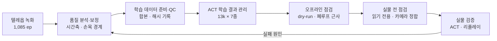

카메라 3대(탑뷰 · 사이드 · 손목)로 녹화하고 실행했다.

**기술 스택 (실제로 사용한 것만)**
- **데이터:** LeRobot v3 데이터셋, parquet·AV1 영상, Hugging Face Hub(업로드·SHA-256 대조)
- **로봇·센서:** Dynamixel XL430/XL330 + OpenRB-150(레지스터 읽기 점검), RealSense D435, USB 카메라(OpenCV)
- **학습·추론:** ACT 정책. 학습은 별도 GPU PC, 노트북에서는 CPU 추론·오프라인 dry-run
- **도구:** Python, pandas/numpy, matplotlib, PyAV, ffmpeg, Git
- **AI 코딩 도구:** Claude Code, Codex. 지시·검토 방식으로 사용했고 출처를 [scripts/README.md](scripts/README.md)에 명시함

---

## 실물 검증 — ACT 자율 구동과 리플레이를 구분해서

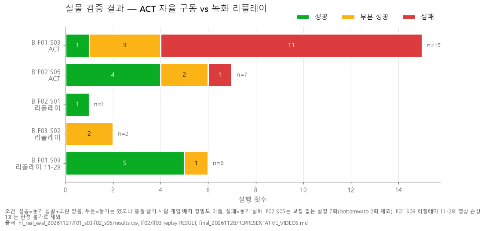

| 검증 | 방식 | 모델 / 체크포인트 | 결과 | 영상 |
|---|---|---|---|---|
| [B팔 F02 S05](docs/physical-validation-F02-S05.md) | **ACT 자율** | F02 wristfix · Best 12000 | 7회 중 **깨끗한 성공 4**(00:25–00:27 연속 3회), 충돌 동반 2, 실패 1 | [02](assets/media/videos/02_B-F02-S05_ACT_success_20261127-0025_ep1.mp4) · [03](assets/media/videos/03_B-F02-S05_ACT_success_20261127-0026_ep2.mp4) · [04](assets/media/videos/04_B-F02-S05_ACT_success_20261127-0027_ep3.mp4) · [05](assets/media/videos/05_B-F02-S05_ACT_success_20261127-0036.mp4) |
| [B팔 F01 S03](docs/physical-validation-F01-S03.md) | **ACT 자율** | F01 · Best 12000 | 15회 중 **깨끗한 성공 1**, 놓기만 성공 3, 실패 11 | [01](assets/media/videos/01_B-F01-S03_ACT_success_20261126-2348.mp4) |
| [B팔 F02 S01](docs/physical-validation-F02-S01.md) | 리플레이 (정책 아님) | — | 1/1 성공 | [06](assets/media/videos/06_B-F02-S01_REPLAY_success_20261125.mp4) |
| B팔 F03 S02 | 리플레이 (정책 아님) | — | 2회 모두 **부분 성공** — 배치 정밀도 미흡(11-28 재판정) · ACT는 손목 브래킷 변경으로 실행 보류 | [07](assets/media/videos/07_B-F03-S02_REPLAY_partial_20261127-2054.mp4) · [08](assets/media/videos/08_B-F03-S02_REPLAY_partial_20261127-2057.mp4) |
| B팔 F01 S03 (11-28) | 리플레이 (정책 아님) | — | 6회 중 놓기 성공 5, 사람 손 개입 1 | [09](assets/media/videos/09_B-F01-S03_REPLAY_success_20261128-0254.mp4) |

**실패도 그대로 기록했다** — 운반 중 충돌, 복귀 중 끌기, 집기 반복 실패 ([부분 성공](docs/videos.md#-3-부분-성공) · [실패](docs/videos.md#-4-실패) 영상).

**오프라인 평가는 실물보다 높게 나왔다.** 근사 시뮬은 접촉·충돌·카메라 이동을 반영하지 못한다. 표본이 작아(7–15회) 비율은 참고용이다.

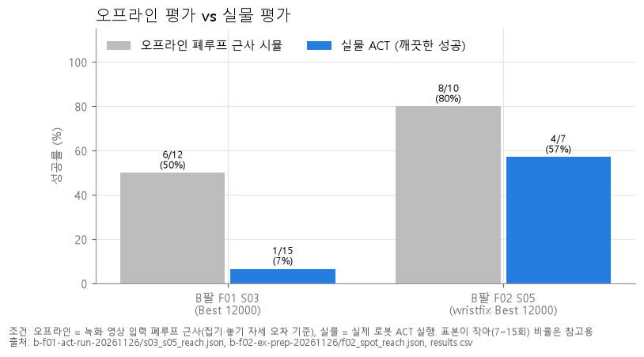

**안전층:** 실행 전 읽기 전용 점검(USB·한도·자세·카메라), 학습 범위 ±8 관절 제한, 2단계 park 복귀, 고정 PID 적용을 로그로 확인했다. 점검이 FAIL이면 실행하지 않았고, 위험한 시도(정면 카메라 보정)는 즉시 중단하고 사용 금지로 판정했다. → [안전 점검 기록](docs/evidence-gallery.md#실행-전-점검-항목-읽기-전용-모터-쓰기-없음) · [성공·실패 원인 분석](docs/success-failure-analysis.md)

---

## ACT 학습

팔(A=오른팔, B=왼팔) × 층(F01/F02/F03/EX) **7종**, 13,000 step, 1,000 step마다 체크포인트.

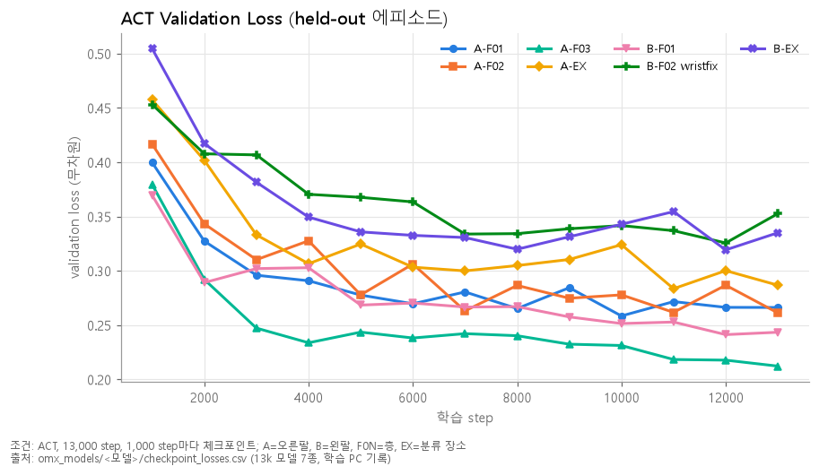 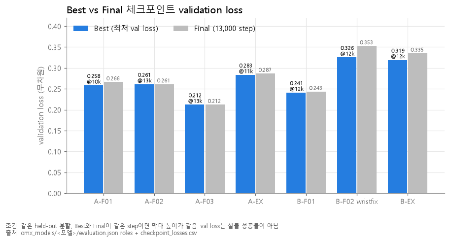

- Best validation loss **0.2122 ~ 0.3256**. 일곱 모델 모두 Final(13,000)보다 Best가 같거나 낮다.
- 실물에 쓴 B팔 F01·F02는 Best 12000. val loss가 낮다고 실물 성공률이 높은 것은 아니다(F01 0.241 → 실물 1/15, F02 0.326 → 실물 4/7).
- 관절별 오프라인 오차는 elbow_flex·shoulder_lift가 가장 크다(B팔 F02 held-out 12 ep 기준) → [그래프 4](docs/graphs.md#4-관절별-예측값-vs-실제값-오차)
- → [학습 이력](docs/act-training-history.md) · [Training loss 그래프](docs/graphs.md#1-act-training-loss)

---

## 데이터 수집과 품질

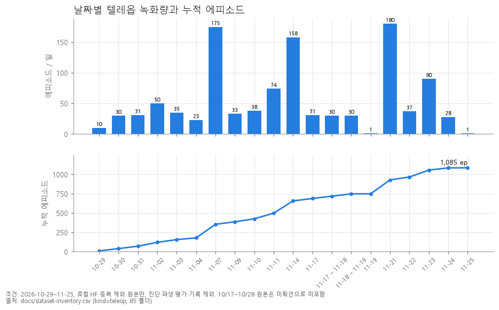 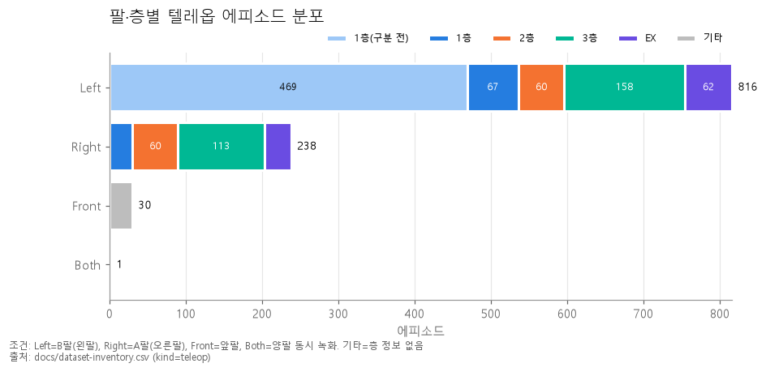

텔레오퍼레이션 시연 영상(사람이 리더 팔로 조작한 학습 데이터, 자율 구동 아님): A팔 1·2·3층, A·B팔 EX 분류 장소 → [영상 14–18](docs/videos.md#-5-텔레오퍼레이션-데이터-수집-학습용-시연--자율-구동-아님)

### 손목 경계 오류를 찾아 보정
Left F02 60 ep에서 손목 action이 state와 폴더마다 51–55 단위 어긋나 ±100 경계를 넘나들었다. 녹화 코드 수정 시각보다 먼저 녹화된 데이터였다.

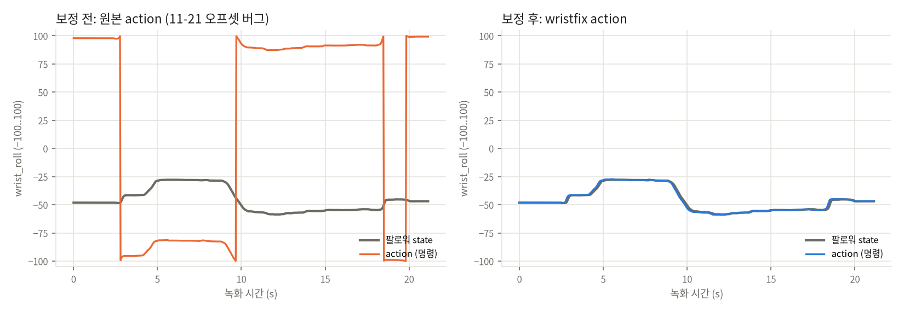

- \|action − state\| 중앙값 **145 → 0.3**, 경계 점프 **49 → 0** → 보정 데이터로 재학습한 모델이 위의 F02 S05 실물 성공 4회를 냈다.
- 녹화 중 같은 오류를 잡도록 손목 action 감시와 안전 중단을 팀 앱에 추가했다.
- → [손목 오프셋 분석](docs/wrist-fix-analysis.md) · [그래프 7](docs/graphs.md#7-손목-경계-보정-전후)

### 그 밖의 데이터 오류
- **시간축 압축 (11/14, 158 ep):** 표기 30 Hz ↔ 실제 13–15 Hz. 실제 38.26 s가 16.0 s로 저장됨
- **0.5초 정지가 1프레임으로 압축:** 시간 왜곡 3–5 %
- → [데이터 품질 분석](docs/data-quality-analysis.md)

---

## 카메라 정합과 하드웨어

학습 화면과 실행 직전 라이브 화면을 50 %로 겹쳐 카메라 이동을 확인했다(비교 이미지는 비공개).

- 탑뷰 카메라 이동을 특징점 정합으로 측정·보정: 이동 19.4 px → 잔차 0.44 px, 회전 0.67° → 0.03° ([그래프 8](docs/graphs.md#8-카메라-정합-전후-오차))
- 다음 날에는 카메라가 원래 자리로 돌아와 같은 보정이 오히려 37 px 어긋났다 → 실행마다 다시 측정하고, 보정 없이 실행했다. 보정 효과는 **미확정**.
- **sync-read 0.5초 멈춤:** 팔로워 Return_Delay_Time 50 적용. 40초 측정에서 읽기 실패 2.54 % → 0 %, 녹화형 루프 최대 지연 547 → 42 ms. 실제 작업 중에는 멈춤이 약 1/6로 줄었지만 팔이 움직일 때 남아 있음
- **정책 실행 경로의 PID 게인 누락:** shoulder_lift가 라이브러리 기본값(P4000/D600)으로 동작하던 것을 찾아 고정값 적용을 로그로 확인
- **모터 부하·추종 오차:** 리플레이 실행 중 0.1초 간격 기록 → [그래프 11](docs/graphs.md#11-모터-부하관절-추종-오차-리플레이-실측)
- **미해결:** ID13 elbow 과부하, 실행 루프 2 Hz 순간 정지 → [하드웨어 디버깅 기록](docs/hardware-debugging.md)

---

## 개인 기여 — 팀 성과와 내 업무의 구분

| 구분 | 내용 | 근거 |
|---|---|---|
| **팀 전체** | OMX 앱(녹화·텔레옵·정책 실행) 본체, 플랫폼 저장소 운영, 학습 GPU 환경 | 팀 저장소 커밋 대다수는 다른 팀원 작성 |
| **내 업무 — 데이터** | 텔레옵 녹화 운영, 인벤토리·HF 정리, SHA-256 검증 | 녹화 원본 85개 폴더, HF 대조 기록 |
| **내 업무 — 품질** | 시간축·손목 경계·정지 압축 분석, 보정본 검증 | 분석 문서, [scripts/](scripts/README.md) |
| **내 업무 — 코드** | 팀 앱 기능·수정 커밋 10건: 포트 자동 감지, 상대 추종, 손목 감시·안전 중단, Return_Delay_Time, 오프라인 Auto Homing(미병합) | [GitHub 기여 기록](docs/github-contributions.md) |
| **내 업무 — 검증** | 실행 전 점검, 카메라 정합 판정, 실물 ACT·리플레이 실행과 판정 | 실행 로그, 탑뷰 영상, 결과표 |
| **협업** | 팀 플랫폼 이슈 2건 담당(역할·인수인계) | [#305](https://github.com/robotics-team-1213/rosy-platform/issues/305) |
| **AI 협업** | 코드·분석 스크립트·문서 작성에 Claude Code·Codex 사용. 로봇 조작·안전 판단·결과 판정은 본인 | 커밋 꼬리말, [scripts/README.md](scripts/README.md) |

---

## 문서 지도

| 분야 | 문서 |
|---|---|
| 시각 자료 | [영상 목록](docs/videos.md) · [학습·검증 그래프](docs/graphs.md) · [증빙 이미지](docs/evidence-gallery.md) |
| 데이터 수집·관리 | [data-collection-timeline.md](docs/data-collection-timeline.md) · [dataset-inventory.csv](docs/dataset-inventory.csv) |
| 데이터 품질 | [data-quality-analysis.md](docs/data-quality-analysis.md) · [wrist-fix-analysis.md](docs/wrist-fix-analysis.md) |
| ACT 모방학습 | [act-training-history.md](docs/act-training-history.md) |
| 하드웨어·통신 | [hardware-debugging.md](docs/hardware-debugging.md) |
| 실물 검증 | [F01-S03](docs/physical-validation-F01-S03.md) · [F02-S01](docs/physical-validation-F02-S01.md) · [F02-S05](docs/physical-validation-F02-S05.md) · [성공·실패 분석](docs/success-failure-analysis.md) |
| 역할·기여 | [engineering-contribution.md](docs/engineering-contribution.md) · [github-contributions.md](docs/github-contributions.md) · [interview-summary.md](docs/interview-summary.md) |
| 증빙·공개 범위 | [evidence-and-huggingface-links.md](docs/evidence-and-huggingface-links.md) |
| 코드 | [scripts/](scripts/README.md) · 그래프 재생성 [tools/](tools/) |

---

## 공개 범위
- 이 저장소는 공개 저장소다. 공개 전에 팀 내부 정보, 다른 팀원의 코드, 인증정보, 개인정보, 장치 식별자를 검사했다.
- 실물 탑뷰 영상 18개는 공개 승인을 받아 실었다. 공개 전에 모든 프레임을 검사해 사람이 나오는 구간을 잘라냈고, 소리·위치·기기 정보는 없다.
- 사이드·손목 카메라 영상, 실험 환경 사진, Hugging Face 링크(프로필 포함)는 싣지 않는다. 원본 녹화·모델은 Hugging Face(Purple-SY)에 있으며 저장소 이름·통계·SHA-256 결과만 공개한다.
- 미해결 문제와 미확인 수치를 숨기지 않고 각 문서에 기록했다.
