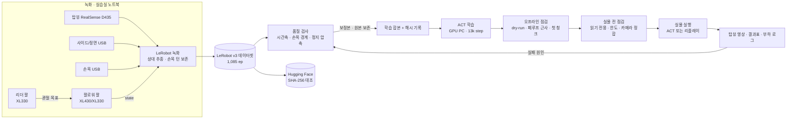

# 기술 개발 증빙 이미지

작성: **PURPLE-SY (김승용)**

> **이 공개본에는 카메라·실험 환경 이미지를 싣지 않았습니다**(팀 공개 승인 대기). 이미지 자리에는 무엇을 보여 주는지와 측정값만 남겼습니다.

## 시스템 아키텍처와 데이터 처리 파이프라인

## 카메라 정합

### 50 % 반투명 비교 — 학습 화면 vs 실행 직전 라이브 화면
왼쪽부터 학습 데이터 첫 프레임, 실행 직전 라이브 프레임, 두 장을 50 %로 겹친 화면입니다. 겹친 화면에서 경계가 두 겹으로 보이면 카메라가 움직인 것입니다.

**B팔 F01 S03 탑뷰 (2026-11-26, 보정 전)** — 학습 대비 이동 약 (-18, -5) px, 회전 0.87°

_(영상·이미지 공개 보류 — 팀 공개 승인 대기)_ F01 S03 탑뷰 겹침

**B팔 F01 S03 정면(bottom) 카메라** — 학습 대비 이동 약 (-19, -3) px, 회전 -1.8°

_(영상·이미지 공개 보류 — 팀 공개 승인 대기)_ F01 S03 정면 겹침

- 출처: `b-f01-act-run-20261126/check_20261126_s03/cam/cmp_11_23_F01_S03_{top,bottom}.jpg`, 수치 `cam_compare.json`
- 손목 카메라는 특징점이 부족해 정합에 실패했습니다(같은 파일 기록).
- 보정(특징점 정합 → 아핀 변환) 후 탑뷰 잔차: 이동 0.44 px, 회전 0.03° ([그래프 8](graphs.md#8-카메라-정합-전후-오차)). 이 보정 사본으로 23:48 성공 1회가 나왔지만, 보정이 성공 원인이라고 확정하지는 못했습니다.

### 정합 보정이 오히려 해가 된 사례 — B팔 F02 S05 (2026-11-27)

| 보정 없음 (실제 사용) | 이전 보정값 적용 (사용 안 함) |
|---|---|
| (이미지 보류) | (이미지 보류) |
| 학습 대비 (-5, +1) px, 0.3° | 하루 전 측정한 보정을 적용하면 (-37, -9) px로 더 어긋남 |

- 카메라가 학습 구도로 돌아와 있었기 때문입니다. 그래서 F02 S05는 보정 없는 사본으로 실행했고 깨끗한 성공 4회가 나왔습니다.
- 정면 카메라 보정(`bottomwarp`)은 실물에서 다른 컨테이너를 집어 떨어뜨리는 위험 동작이 나와 **사용 금지**로 판정했습니다.
- 출처: `hf_real_eval_20261127/f02_s05/summary/cmp_top{,_warped}.jpg`, `kit_REPORT.md`

## 데이터 수집과 검증 화면

**리플레이 3시점 (탑뷰 · 사이드 · 손목)** — 같은 실행, 같은 시점

_(영상·이미지 공개 보류 — 팀 공개 승인 대기)_ F03 S02 3시점

**F02 S01 리플레이 요약 시트** — 시작·집기·놓기·복귀 장면

_(영상·이미지 공개 보류 — 팀 공개 승인 대기)_ F02 S01 리플레이 시트

**대표 실행 9개 비교 시트**

_(영상·이미지 공개 보류 — 팀 공개 승인 대기)_ 대표 실행 시트

## ACT 실행과 안전성 검사

**F02 S05 학습 데이터의 배치** — 실행 전에 트레이 배치를 학습 때와 맞췄습니다.

_(영상·이미지 공개 보류 — 팀 공개 승인 대기)_ F02 S05 학습 배치

**F02 S05 연속 성공 3회의 시작 장면 비교**

_(영상·이미지 공개 보류 — 팀 공개 승인 대기)_ F02 S05 시작 장면

**F02 S05 00:25 ACT 실행 시트**

_(영상·이미지 공개 보류 — 팀 공개 승인 대기)_ F02 S05 실행 시트

**F01 S03 23:56 — 놓기 후 복귀 중 끌기(실패 원인 분석용)**

_(영상·이미지 공개 보류 — 팀 공개 승인 대기)_ F01 S03 끌기

### 실행 전 점검 항목 (읽기 전용, 모터 쓰기 없음)
2026-11-26 23:35 B팔 F01 S03 점검 기록 요약입니다. 점검이 FAIL이면 실행하지 않았습니다.

| 항목 | 첫 점검 | 재점검 후 |
|---|---|---|
| USB 안정성 (sync_read 900회) | FAIL — 시험 중 USB 분리 | PASS — 실패 0, p99 2.7 ms |
| 토크·하드웨어 오류·온도·전압 | PASS | PASS |
| PWM / 전류 한도 | FAIL — 20 / 50으로 낮아져 있음 | 복원 후 PASS (885 / 500, 담당자 승인) |
| 시작 자세 (학습 범위 안) | FAIL — wrist_roll 범위 밖 | PASS |
| 카메라 구도 | 미실시 | 탑뷰 이동 → 보정 사본 사용 |
| 고정 PID 게인 | 코드 PASS | 실행 로그에서 `gains fixed` 확인 |

출처: `hf_real_eval_20261127/f01_s03/summary/preflight_check_RESULT.md`

## 없는 증빙 (찾지 못함)

| 요청 항목 | 상태 |
|---|---|
| 학습 모니터 **화면 스크린샷** | 모니터 HTML만 있음. 브라우저에서 열어 캡처하면 추가 가능 |
| 로봇팔 전체 모습 사진 | 탑뷰·정면 카메라 장면만 있음. 휴대폰 촬영 사진·영상 예정 |
| 앱 실행 화면 캡처 | 없음 |
