# 학습·검증 그래프

작성: **PURPLE-SY (김승용)**

모든 그래프는 기록된 로그에서 다시 그렸습니다. 로그가 없는 항목은 그리지 않고 아래 **없는 그래프**에 적었습니다.
다시 만들기: `python tools/make_graphs.py <src_light> <src_backup>` (외장 HDD 백업 사본 경로). 그린 숫자는 [`graph_data.json`](../assets/graphs/graph_data.json)에 그대로 있습니다.
각 그래프 아래 표는 색을 구분하기 어려울 때 읽는 데이터 표입니다.

## 1. ACT Training Loss

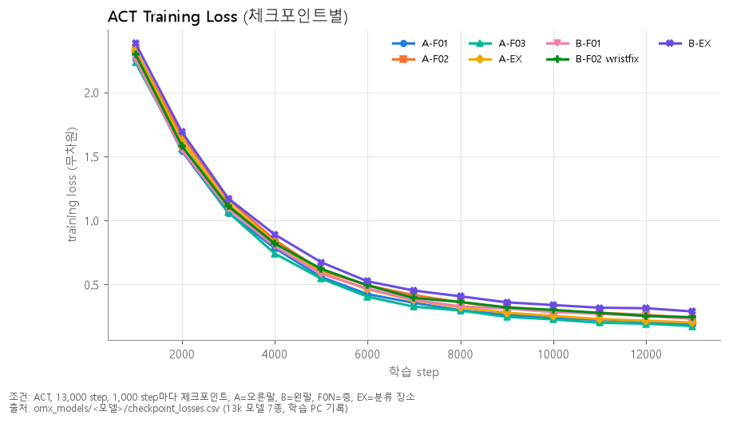

- **조건:** ACT, 13,000 step, 1,000 step마다 체크포인트; A=오른팔, B=왼팔, F0N=층, EX=분류 장소
- **출처:** `omx_models/<모델>/checkpoint_losses.csv (13k 모델 7종, 학습 PC 기록)`

| step | A-F01 | A-F02 | A-F03 | A-EX | B-F01 | B-F02 wristfix | B-EX |
|---:|---:|---:|---:|---:|---:|---:|---:|
| 1,000 | 2.258 | 2.332 | 2.233 | 2.326 | 2.255 | 2.299 | 2.382 |
| 2,000 | 1.542 | 1.659 | 1.562 | 1.621 | 1.55 | 1.582 | 1.691 |
| 3,000 | 1.06 | 1.163 | 1.063 | 1.13 | 1.09 | 1.112 | 1.172 |
| 4,000 | 0.784 | 0.849 | 0.742 | 0.83 | 0.799 | 0.82 | 0.891 |
| 5,000 | 0.559 | 0.609 | 0.547 | 0.591 | 0.583 | 0.623 | 0.674 |
| 6,000 | 0.425 | 0.494 | 0.405 | 0.463 | 0.469 | 0.494 | 0.525 |
| 7,000 | 0.357 | 0.417 | 0.327 | 0.376 | 0.38 | 0.395 | 0.453 |
| 8,000 | 0.299 | 0.362 | 0.297 | 0.321 | 0.33 | 0.364 | 0.408 |
| 9,000 | 0.264 | 0.316 | 0.248 | 0.28 | 0.313 | 0.322 | 0.361 |
| 10,000 | 0.24 | 0.285 | 0.228 | 0.255 | 0.286 | 0.302 | 0.34 |
| 11,000 | 0.224 | 0.279 | 0.202 | 0.231 | 0.271 | 0.279 | 0.319 |
| 12,000 | 0.21 | 0.264 | 0.194 | 0.217 | 0.255 | 0.255 | 0.315 |
| 13,000 | 0.19 | 0.238 | 0.176 | 0.204 | 0.232 | 0.245 | 0.29 |

## 2. Validation Loss

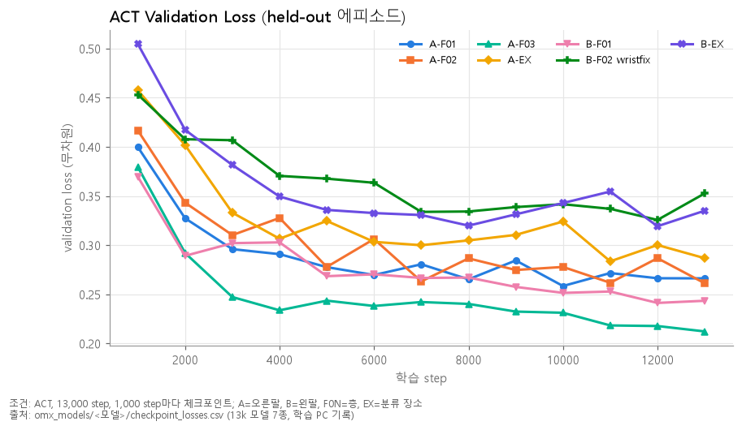

- **조건:** ACT, 13,000 step, 1,000 step마다 체크포인트; A=오른팔, B=왼팔, F0N=층, EX=분류 장소
- **출처:** `omx_models/<모델>/checkpoint_losses.csv (13k 모델 7종, 학습 PC 기록)`

| step | A-F01 | A-F02 | A-F03 | A-EX | B-F01 | B-F02 wristfix | B-EX |
|---:|---:|---:|---:|---:|---:|---:|---:|
| 1,000 | 0.3997 | 0.4166 | 0.3794 | 0.4574 | 0.3695 | 0.4531 | 0.5045 |
| 2,000 | 0.3273 | 0.3432 | 0.292 | 0.4017 | 0.2891 | 0.4077 | 0.4172 |
| 3,000 | 0.2959 | 0.3102 | 0.2472 | 0.333 | 0.302 | 0.4067 | 0.3815 |
| 4,000 | 0.2908 | 0.3276 | 0.2337 | 0.3065 | 0.3028 | 0.3704 | 0.3494 |
| 5,000 | 0.2776 | 0.2778 | 0.2435 | 0.3246 | 0.2684 | 0.3676 | 0.3358 |
| 6,000 | 0.2696 | 0.3062 | 0.2381 | 0.3033 | 0.2703 | 0.3634 | 0.3326 |
| 7,000 | 0.2805 | 0.2631 | 0.2421 | 0.2999 | 0.2666 | 0.3338 | 0.3306 |
| 8,000 | 0.2652 | 0.2865 | 0.2402 | 0.3048 | 0.267 | 0.3342 | 0.3198 |
| 9,000 | 0.2844 | 0.2747 | 0.2324 | 0.3104 | 0.2575 | 0.3387 | 0.3313 |
| 10,000 | 0.2584 | 0.2778 | 0.2312 | 0.324 | 0.2514 | 0.3416 | 0.3428 |
| 11,000 | 0.2716 | 0.2617 | 0.2183 | 0.2835 | 0.2528 | 0.3369 | 0.3545 |
| 12,000 | 0.2663 | 0.2867 | 0.2177 | 0.3001 | 0.2412 | 0.3256 | 0.3192 |
| 13,000 | 0.2662 | 0.2612 | 0.2122 | 0.2867 | 0.2434 | 0.3526 | 0.335 |

## 3. Best vs Final 모델

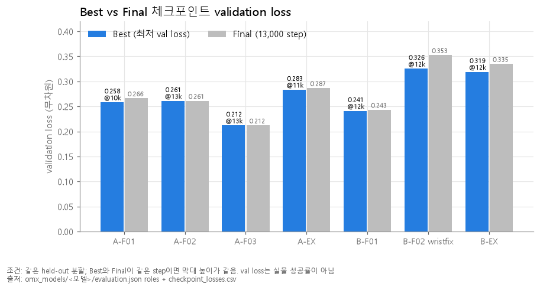

- **조건:** 같은 held-out 분할; Best와 Final이 같은 step이면 막대 높이가 같음. val loss는 실물 성공률이 아님
- **출처:** `omx_models/<모델>/evaluation.json roles + checkpoint_losses.csv`

| 모델 | Best step | Best val | Final step | Final val |
|---|---:|---:|---:|---:|
| A-F01 | 10,000 | 0.2584 | 13,000 | 0.2662 |
| A-F02 | 13,000 | 0.2612 | 13,000 | 0.2612 |
| A-F03 | 13,000 | 0.2122 | 13,000 | 0.2122 |
| A-EX | 11,000 | 0.2835 | 13,000 | 0.2867 |
| B-F01 | 12,000 | 0.2412 | 13,000 | 0.2434 |
| B-F02 wristfix | 12,000 | 0.3256 | 13,000 | 0.3526 |
| B-EX | 12,000 | 0.3192 | 13,000 | 0.3350 |

## 4. 관절별 예측값 vs 실제값 오차

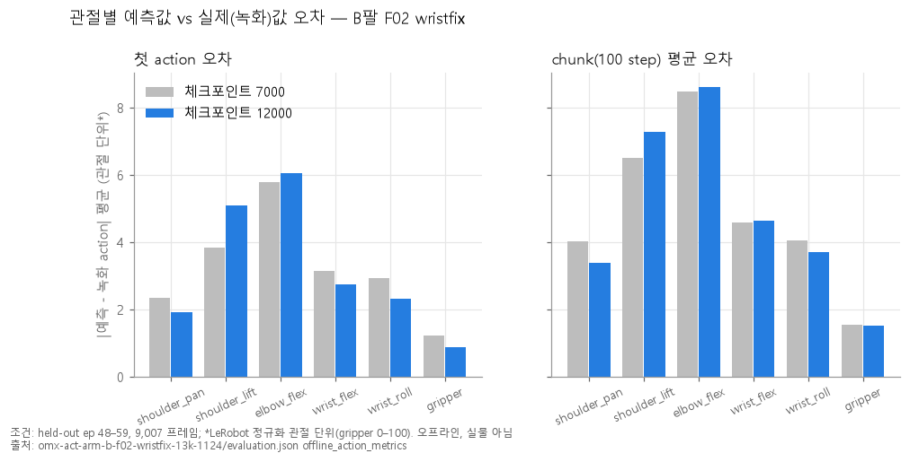

- **조건:** held-out ep 48–59, 9,007 프레임; *LeRobot 정규화 관절 단위(gripper 0–100). 오프라인, 실물 아님
- **출처:** `omx-act-arm-b-f02-wristfix-13k-1124/evaluation.json offline_action_metrics`

| 체크포인트 | 지표 | shoulder_pan | shoulder_lift | elbow_flex | wrist_flex | wrist_roll | gripper |
|---|---|---:|---:|---:|---:|---:|---:|
| 7,000 | first_mae | 2.34 | 3.83 | 5.79 | 3.13 | 2.93 | 1.23 |
| 7,000 | chunk_mae | 4.03 | 6.52 | 8.49 | 4.57 | 4.05 | 1.55 |
| 12,000 | first_mae | 1.93 | 5.10 | 6.05 | 2.75 | 2.32 | 0.88 |
| 12,000 | chunk_mae | 3.37 | 7.29 | 8.61 | 4.64 | 3.71 | 1.51 |

## 5. 날짜별 수집량과 누적 에피소드

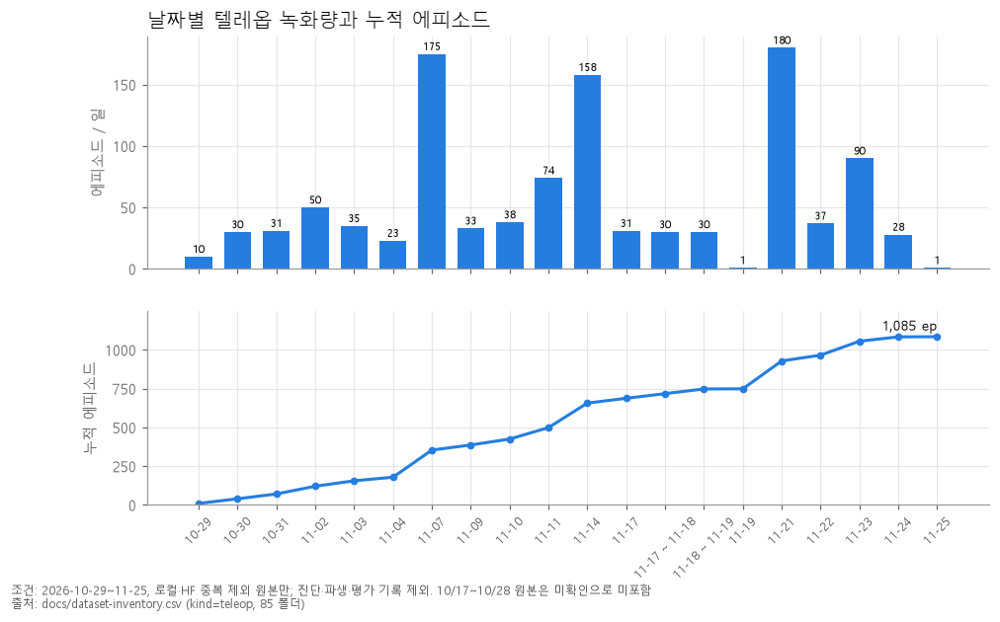

- **조건:** 2026-10-29–11-25, 로컬·HF 중복 제외 원본만; 진단·파생·평가 기록 제외. 10/17–10/28 원본은 미확인으로 미포함
- **출처:** `docs/dataset-inventory.csv (kind=teleop, 85 폴더)`

| 날짜 | 에피소드 | 누적 |
|---|---:|---:|
| 2026-10-29 | 10 | 10 |
| 2026-10-30 | 30 | 40 |
| 2026-10-31 | 31 | 71 |
| 2026-11-02 | 50 | 121 |
| 2026-11-03 | 35 | 156 |
| 2026-11-04 | 23 | 179 |
| 2026-11-07 | 175 | 354 |
| 2026-11-09 | 33 | 387 |
| 2026-11-10 | 38 | 425 |
| 2026-11-11 | 74 | 499 |
| 2026-11-14 | 158 | 657 |
| 2026-11-17 | 31 | 688 |
| 2026-11-17 ~ 11-18 | 30 | 718 |
| 2026-11-18 ~ 11-19 | 30 | 748 |
| 2026-11-19 | 1 | 749 |
| 2026-11-21 | 180 | 929 |
| 2026-11-22 | 37 | 966 |
| 2026-11-23 | 90 | 1,056 |
| 2026-11-24 | 28 | 1,084 |
| 2026-11-25 | 1 | 1,085 |

## 6. 팔·층별 데이터 분포

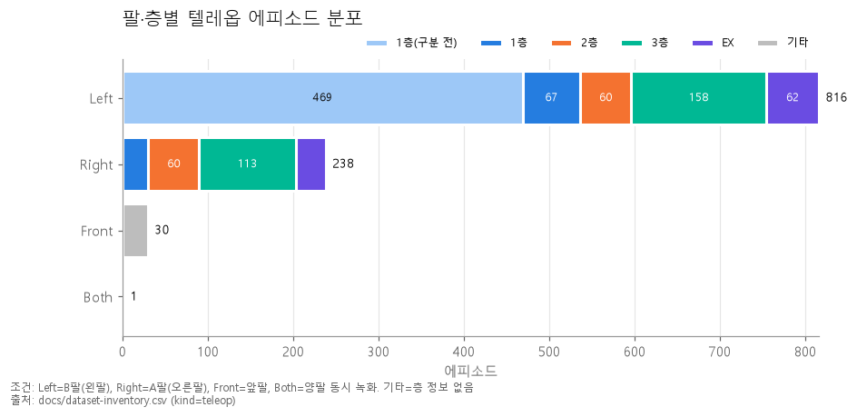

- **조건:** Left=B팔(왼팔), Right=A팔(오른팔), Front=앞팔, Both=양팔 동시 녹화. 기타=층 정보 없음
- **출처:** `docs/dataset-inventory.csv (kind=teleop)`

| 팔 | 1층(구분 전) | 1층 | 2층 | 3층 | EX | 기타 | 합계 |
|---|---:|---:|---:|---:|---:|---:|---:|
| Left | 469 | 67 | 60 | 158 | 62 | 0 | 816 |
| Right | 0 | 30 | 60 | 113 | 35 | 0 | 238 |
| Front | 0 | 0 | 0 | 0 | 0 | 30 | 30 |
| Both | 0 | 0 | 0 | 0 | 0 | 1 | 1 |

## 7. 손목 경계 보정 전후

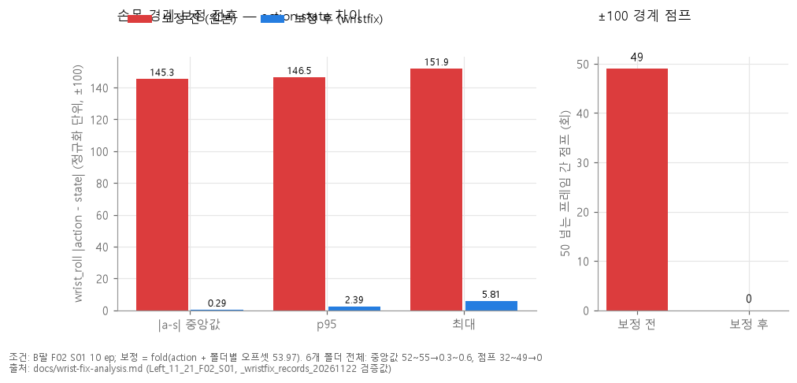

- **조건:** B팔 F02 S01 10 ep; 보정 = fold(action + 폴더별 오프셋 53.97). 6개 폴더 전체: 중앙값 52–55→0.3–0.6, 점프 32–49→0
- **출처:** `docs/wrist-fix-analysis.md (Left_11_21_F02_S01, _wristfix_records_20261122 검증값)`

| 지표 | 보정 전 | 보정 후 |
|---|---:|---:|
| |a-s| 중앙값 | 145.35 | 0.29 |
| p95 | 146.47 | 2.39 |
| 최대 | 151.89 | 5.81 |
| 50 넘는 프레임 간 점프 | 49 | 0 |

원래 시계열(실제 녹화 1개 에피소드의 state와 action):

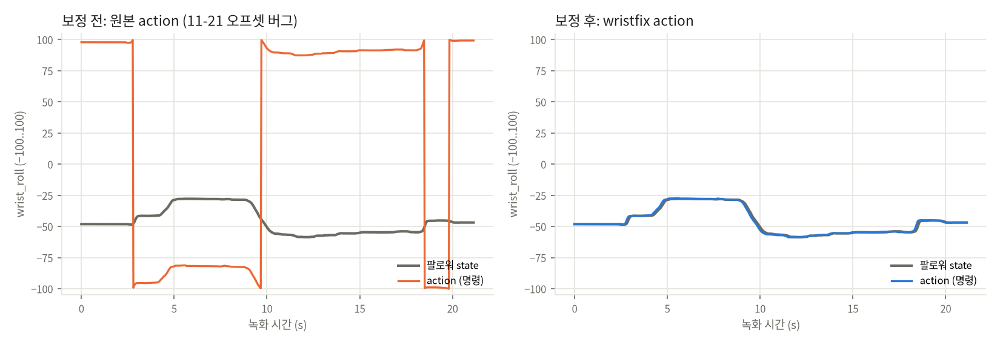

## 8. 카메라 정합 전후 오차

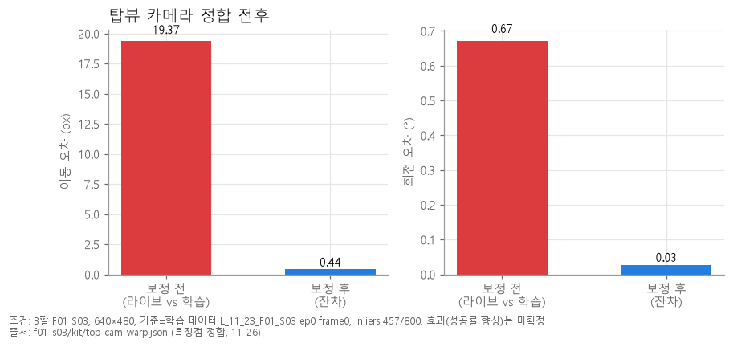

- **조건:** B팔 F01 S03, 640×480, 기준=학습 데이터 L_11_23_F01_S03 ep0 frame0, inliers 457/800. 효과(성공률 향상)는 미확정
- **출처:** `f01_s03/kit/top_cam_warp.json (특징점 정합, 11-26)`

| | 이동 (px) | 회전 (°) |
|---|---:|---:|
| 보정 전 | 19.37 | 0.671 |
| 보정 후 잔차 | 0.44 | 0.026 |

- 반투명(50 %) 비교 이미지: [증빙 이미지](evidence-gallery.md#카메라-정합)
- 주의: F02 S05에서는 카메라가 학습 구도로 돌아와 있어 같은 보정을 적용하면 오히려 (-37, -9) px 어긋났습니다. 그래서 그 실행은 보정 없이 했습니다. 보정 효과(성공률 향상)는 확정하지 못했습니다.

## 9. 실물 검증 결과(성공·부분 성공·실패)

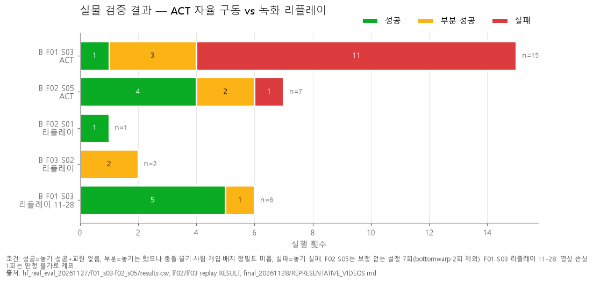

- **조건:** 성공=놓기 성공+교란 없음, 부분=놓기는 했으나 충돌·끌기·사람 개입·배치 정밀도 미흡, 실패=놓기 실패. F02 S05는 보정 없는 설정 7회(bottomwarp 2회 제외). F01 S03 리플레이 11-28: 영상 손상 1회는 판정 불가로 제외
- **출처:** `hf_real_eval_20261127/f01_s03·f02_s05/results.csv, lf02/lf03 replay RESULT, final_20261128/REPRESENTATIVE_VIDEOS.md`

| 실행 | 성공 | 부분 성공 | 실패 | 합계 |
|---|---:|---:|---:|---:|
| B F01 S03 ACT | 1 | 3 | 11 | 15 |
| B F02 S05 ACT | 4 | 2 | 1 | 7 |
| B F02 S01 리플레이 | 1 | 0 | 0 | 1 |
| B F03 S02 리플레이 | 0 | 2 | 0 | 2 |
| B F01 S03 리플레이 11-28 | 5 | 1 | 0 | 6 |

## 10. 오프라인 평가 vs 실물 평가

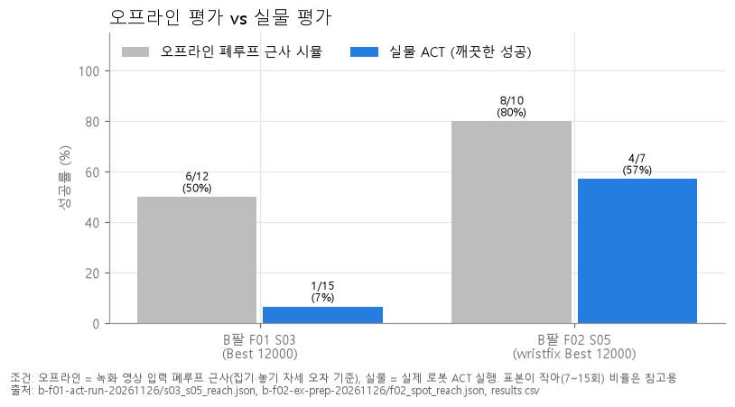

- **조건:** 오프라인 = 녹화 영상 입력 폐루프 근사(집기·놓기 자세 오차 기준), 실물 = 실제 로봇 ACT 실행. 표본이 작아(7–15회) 비율은 참고용
- **출처:** `b-f01-act-run-20261126/s03_s05_reach.json, b-f02-ex-prep-20261126/f02_spot_reach.json, results.csv`

| 위치 | 오프라인 성공 | 실물 깨끗한 성공 |
|---|---:|---:|
| F01 S03 | 6/12 | 1/15 |
| F02 S05 | 8/10 | 4/7 |

오프라인 근사가 실물보다 높게 나옵니다. 근사는 실제 접촉, 다른 컨테이너와의 충돌, 카메라 이동을 반영하지 않습니다.

## 11. 모터 부하·관절 추종 오차 (리플레이 실측)

F02 S01 리플레이(2026-11-25, 0.25배속) 실행 중 0.1초마다 기록한 값입니다. 노트북에서 만든 원본 그림을 그대로 씁니다(데이터: [`11_replay_figures_data.json`](../assets/graphs/11_replay_figures_data.json)).

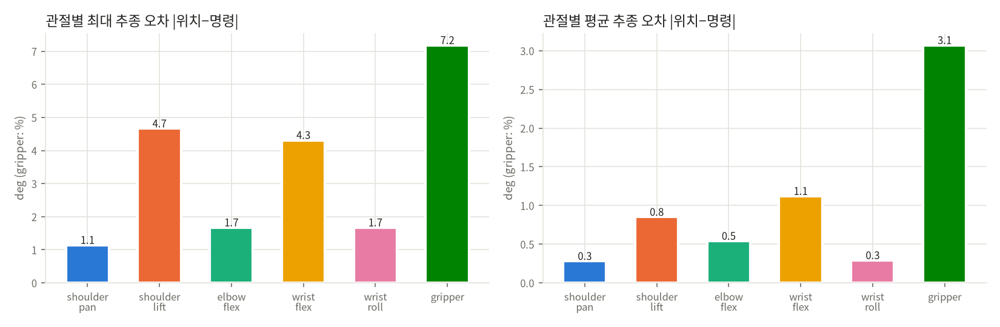
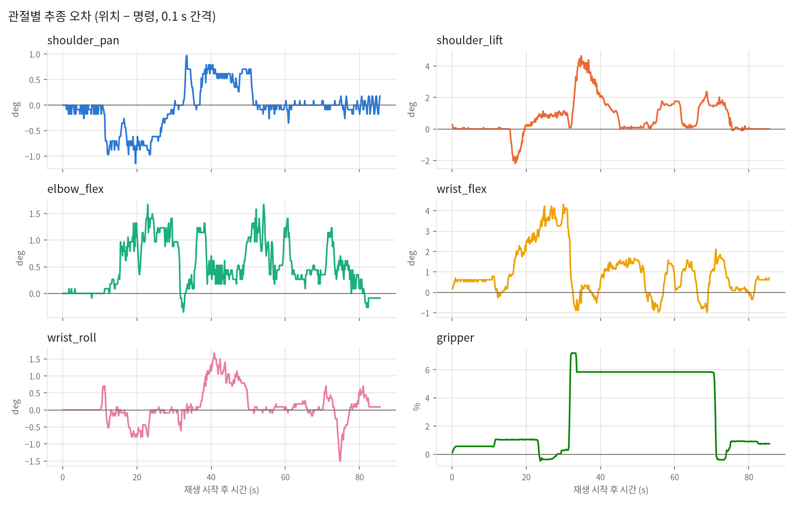
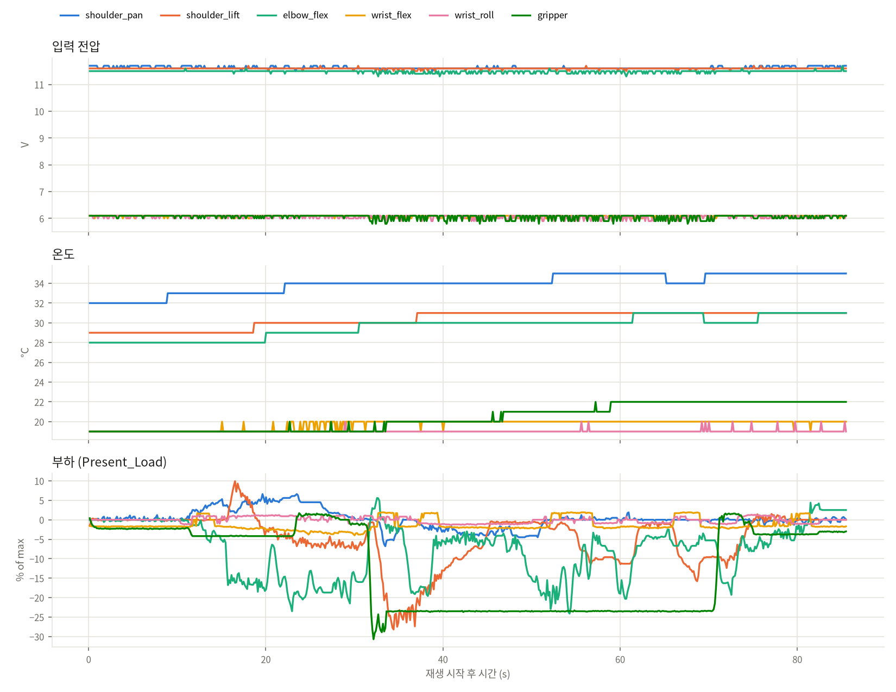
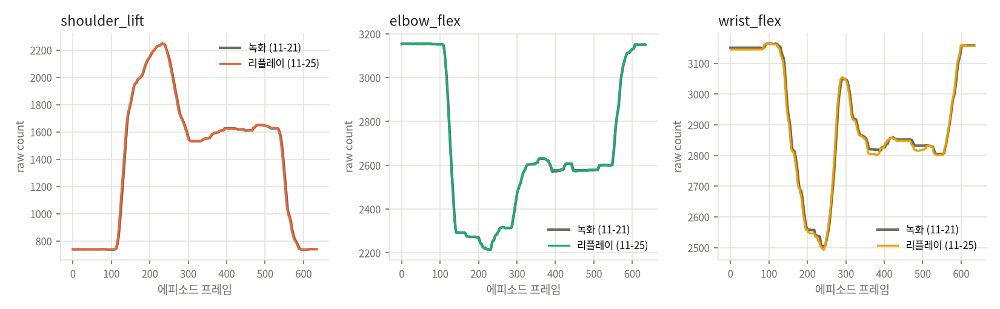

- gripper 추종 오차가 큰 구간은 블록을 쥐고 있어 명령만큼 닫히지 못하는 시간입니다(정상).
- ACT 실행 중 부하는 그래프 없이 로그 최대값만 있습니다: F01 S03 23:48 성공 때 lift 281 / elbow 230, step limit 5 시험 때 358 / 331. F02 S05 elbow 최대 403–463 (bottomwarp 실패 때 511).

## 12. 학습 모니터 원본 그림

학습 PC 모니터가 저장한 B팔 F02 wristfix 학습 그래프 원본입니다.

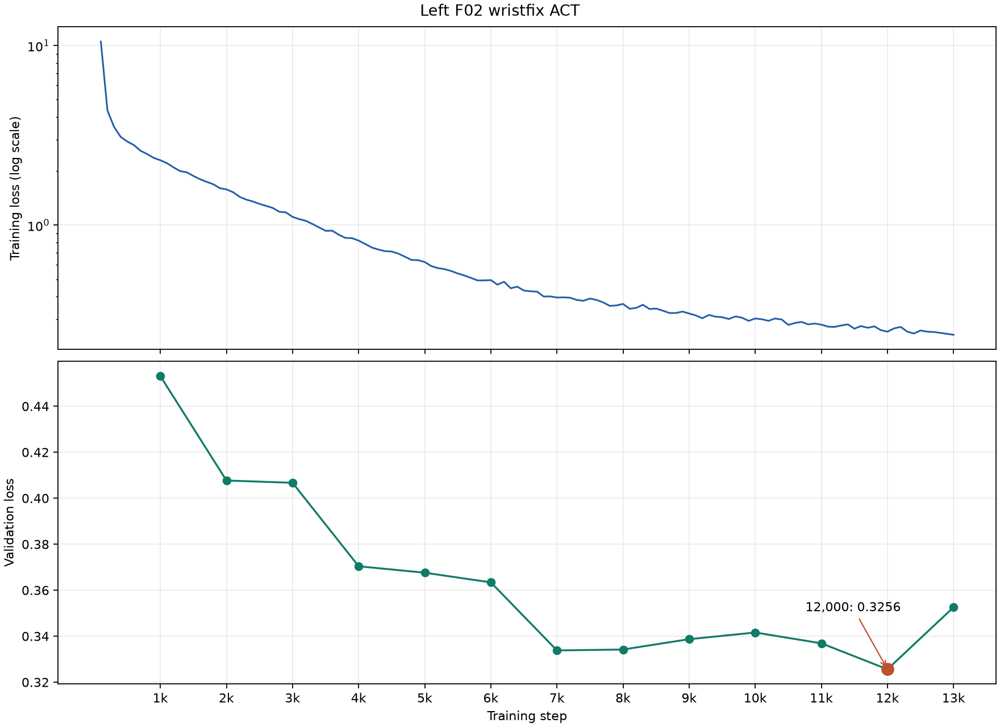

## 없는 그래프 (로그 없음 — 만들지 않음)

| 요청 항목 | 상태 |
|---|---|
| 학습 모니터 **화면 스크린샷** | 모니터 HTML(`OMX ACT 학습 모니터.html`)만 남아 있고 화면 캡처 파일은 없음. 대신 모니터가 저장한 loss 그림(12번)을 씀 |
| ACT 실행 중 관절별 추종 오차 시계열 | 실행 로그에는 최대 부하만 있음. 리플레이(11번)만 시계열 있음 |
| A팔(오른팔) 실물 결과 | A팔은 읽기 전용 점검만 했고 실물 구동 기록 없음 |
| 11-28 00:41–01:38 앱 실행 결과 | 판정 기록 없음(영상 36개 미판정) |
