# 실물 로봇 영상 목록

작성: **PURPLE-SY (김승용)**

모든 영상은 작업대를 위에서 찍은 탑뷰 영상입니다(640×480, H.264, 소리 없음). B팔 = 왼팔, A팔 = 오른팔. **썸네일을 누르면 GitHub 영상 플레이어가 열립니다.**

| 구분 | 뜻 | 영상 |
|---|---|---|
| 🟢 **ACT 자율 구동 — 성공** | 학습한 정책이 카메라 영상과 관절 상태를 보고 스스로 집어 목표 칸에 놓음, 다른 컨테이너 교란 없음 | 01–05 |
| 🔵 **리플레이 — 성공** | 사람이 텔레옵으로 녹화한 관절 명령을 0.25배속으로 다시 재생(**정책 추론 아님**), 목표 칸에 놓음 | 06, 09 |
| 🟡 **부분 성공** | 놓기까지는 했지만 충돌·끌기가 있었거나 배치 정밀도가 부족함 | 07, 08 (리플레이), 10, 12 (ACT) |
| 🔴 **실패** | 목표 칸에 놓지 못함 | 11, 13 (ACT) |
| 🟣 **텔레오퍼레이션 데이터 수집** | 사람이 리더 팔로 팔로워 팔을 조작해 녹화한 학습용 시연(**자율 구동 아님**) | 14–18 |

> 공개본 편집: 02·07·09는 실행이 끝난 뒤 사람 손이 화면에 들어오는 마지막 구간을 잘라냈습니다(아래 각 영상에 원본 길이 표시). 그 밖의 편집은 없습니다. 원본은 비공개로 따로 보관합니다.

## 🟢 1. ACT 자율 구동 — 성공

### 01 · 1층 S03 (윗줄 오른쪽 칸)

<a href="../assets/media/videos/01_B-F01-S03_ACT_success_20261126-2348.mp4">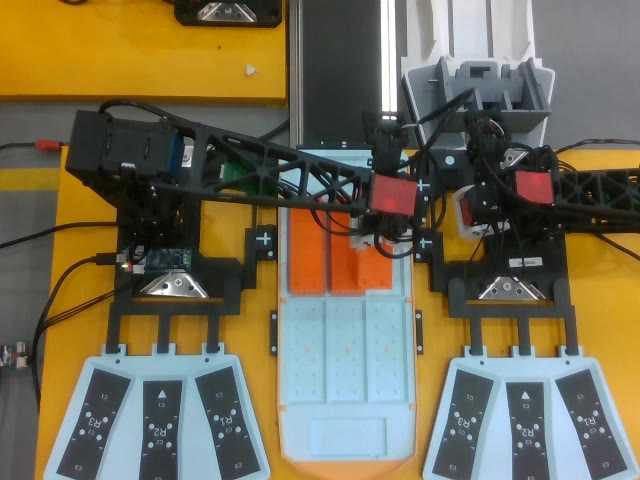</a>

- **날짜·시간:** 2026-11-26 23:48
- **모델 / 체크포인트:** `omx-act-arm-b-f01-13k-1124` Best **012000**, CPU 사본 + 탑뷰 보정(camwarp)
- **결과:** 집기 성공 · 놓기 성공 · 충돌 없음 · 놓기 감지로 18초에 종료, 2단계 park 복귀
- **길이:** 23.7 s

### 02 · 2층 S05 — 연속 성공 1/3

<a href="../assets/media/videos/02_B-F02-S05_ACT_success_20261127-0025_ep1.mp4">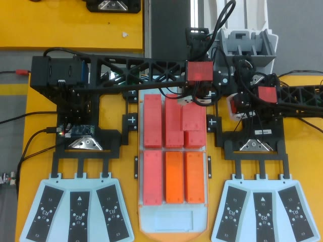</a>

- **날짜·시간:** 2026-11-27 00:25
- **모델 / 체크포인트:** `omx-act-arm-b-f02-wristfix-13k-1124` Best **012000**, CPU 사본(카메라 보정 없음)
- **결과:** 집기 성공 · 놓기 성공(오른쪽으로 약간 치우침) · 충돌 없음
- **길이:** 34.5 s (원본 36.1 s — 끝부분 사람 손 등장 구간 제외)

### 03 · 2층 S05 — 연속 성공 2/3

<a href="../assets/media/videos/03_B-F02-S05_ACT_success_20261127-0026_ep2.mp4">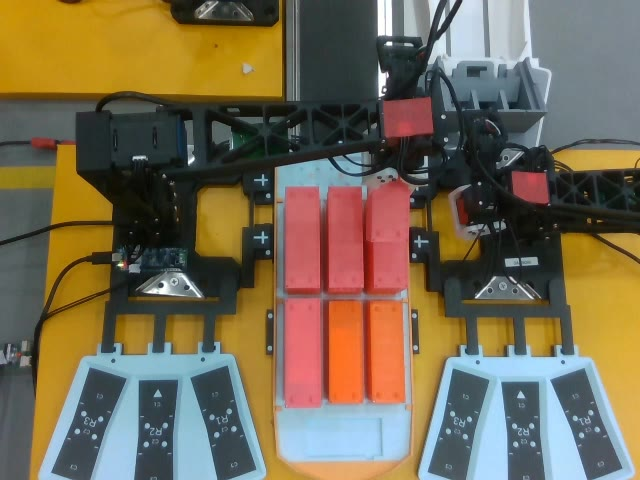</a>

- **날짜·시간:** 2026-11-27 00:26
- **모델 / 체크포인트:** `omx-act-arm-b-f02-wristfix-13k-1124` Best 012000 (02와 같음)
- **결과:** 집기 성공 · 놓기 성공(오른쪽으로 약간 치우침) · 충돌 없음
- **길이:** 36.1 s

### 04 · 2층 S05 — 연속 성공 3/3

<a href="../assets/media/videos/04_B-F02-S05_ACT_success_20261127-0027_ep3.mp4">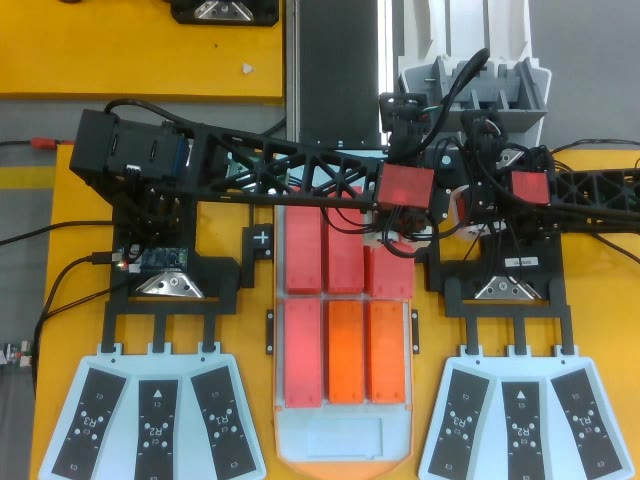</a>

- **날짜·시간:** 2026-11-27 00:27
- **모델 / 체크포인트:** `omx-act-arm-b-f02-wristfix-13k-1124` Best 012000 (02와 같음)
- **결과:** 집기 성공 · 놓기 성공(오른쪽으로 약간 치우침) · 충돌 없음
- **길이:** 36.1 s

### 05 · 2층 S05

<a href="../assets/media/videos/05_B-F02-S05_ACT_success_20261127-0036.mp4">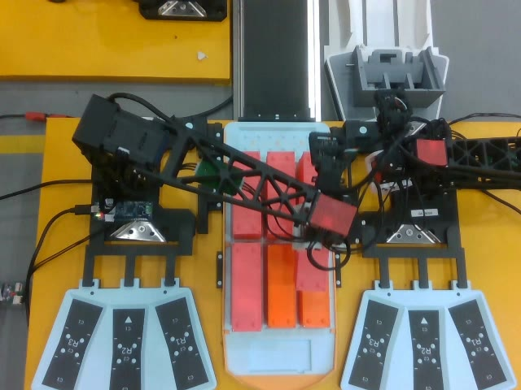</a>

- **날짜·시간:** 2026-11-27 00:36 (모터 전원 재시작으로 ID13 오류를 해제한 뒤)
- **모델 / 체크포인트:** `omx-act-arm-b-f02-wristfix-13k-1124` Best 012000 (02와 같음)
- **결과:** 집기 성공 · 놓기 성공 · 충돌 없음
- **길이:** 34.7 s

## 🔵 2. 녹화 리플레이 — 성공 (정책 아님)

### 06 · 2층 S01

<a href="../assets/media/videos/06_B-F02-S01_REPLAY_success_20261125.mp4">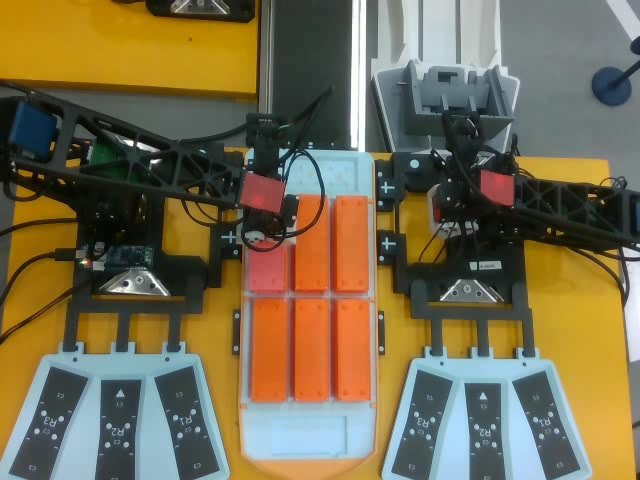</a>

- **날짜·시간:** 2026-11-25 00:37
- **재생한 녹화:** 손목 보정(wristfix) 데이터 S01 ep7 (635 frames), 0.25배속
- **결과:** 성공. 실행 중 안전 감시 정지 0회
- **길이:** 104.4 s

### 09 · 1층 S03 — 리플레이 대표

<a href="../assets/media/videos/09_B-F01-S03_REPLAY_success_20261128-0254.mp4">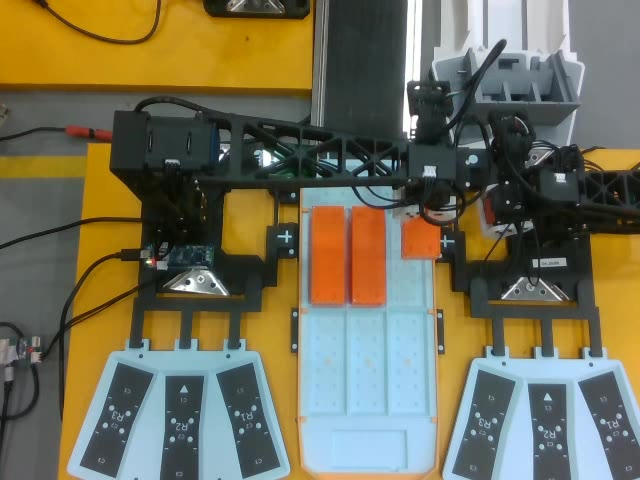</a>

- **날짜·시간:** 2026-11-28 02:54
- **재생한 녹화:** 11-24 녹화 ep1, 0.25배속
- **결과:** 성공(윗줄 3칸 완성). 같은 날 F01 S03 리플레이 6회 중 놓기 성공 5, 사람 손 개입 1 (영상 손상 1회는 판정 제외)
- **길이:** 79.0 s (원본 98.8 s — 실행 뒤 사람 손 등장 구간 제외)

## 🟡 3. 부분 성공

### 07 · 리플레이 · 3층 S02 — 배치 정밀도 미흡

- **날짜·시간:** 2026-11-27 20:54
- **재생한 녹화:** 11-14 녹화 ep28, 0.25배속
- **결과:** 집기·운반·놓기는 끝까지 했으나 놓은 위치의 정밀도가 부족 → 부분 성공 (실행 기록상 "성공", 2026-11-28 재판정)
- **길이:** 67.0 s (원본 100.0 s — 실행 뒤 사람 손 등장 구간 제외)

### 08 · 리플레이 · 3층 S02 — 배치 정밀도 미흡

<a href="../assets/media/videos/08_B-F03-S02_REPLAY_partial_20261127-2057.mp4">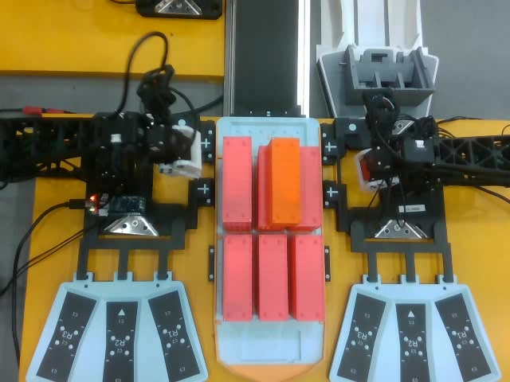</a>

- **날짜·시간:** 2026-11-27 20:57
- **재생한 녹화:** 같은 3층 S02 녹화 계열, 0.25배속
- **결과:** 07과 같은 이유로 부분 성공 (실행 기록상 "성공", 2026-11-28 재판정)
- **길이:** 153.8 s
- F03 S02는 ACT로 실행하지 않았습니다. 손목 브래킷이 바뀌어 정책의 첫 동작 묶음(chunk)이 학습 범위 밖으로 판정됐기 때문입니다.

### 10 · ACT 자율 · 2층 S05 — 운반 중 충돌

<a href="../assets/media/videos/10_B-F02-S05_ACT_collision_20261127-0022.mp4">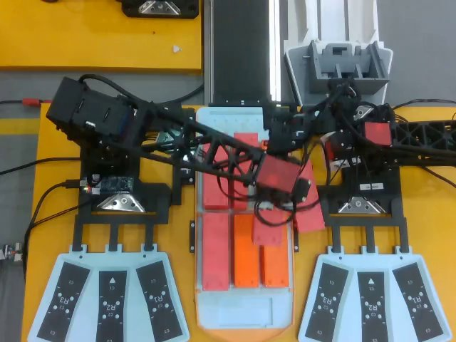</a>

- **날짜·시간:** 2026-11-27 00:22
- **모델 / 체크포인트:** F02 wristfix Best 012000
- **결과:** 놓기는 성공(비스듬). 운반 중 S03 2층 컨테이너를 트레이 밖으로 밀어냄
- **길이:** 35.1 s

### 12 · ACT 자율 · 1층 S03 — 복귀 중 끌기

<a href="../assets/media/videos/12_B-F01-S03_ACT_partial_drag_20261126-2356.mp4">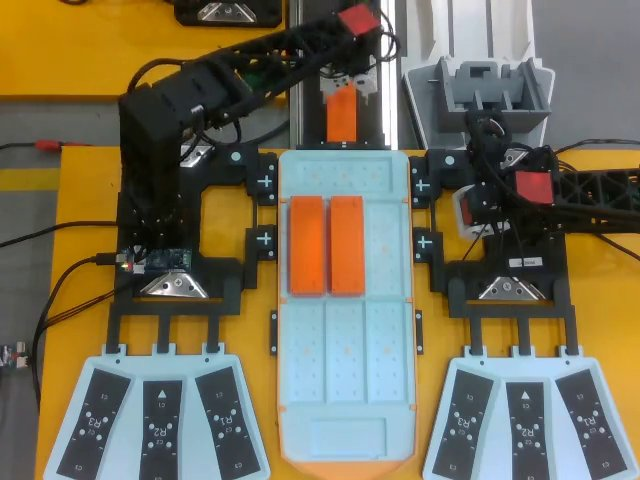</a>

- **날짜·시간:** 2026-11-26 23:56
- **모델 / 체크포인트:** F01 Best 012000 camwarp
- **결과:** 놓기 성공 후 복귀하면서 트레이 컨테이너 2개를 끌어냄. 원인 후보: shoulder_lift 추종 지연(학습 대비 2–2.5배)으로 팔이 계획보다 낮게 지나감(미확정)
- **길이:** 19.9 s

## 🔴 4. 실패

### 11 · ACT 자율 · 2층 S05 — 충돌로 정지

<a href="../assets/media/videos/11_B-F02-S05_ACT_fail_collision_20261127-0037.mp4">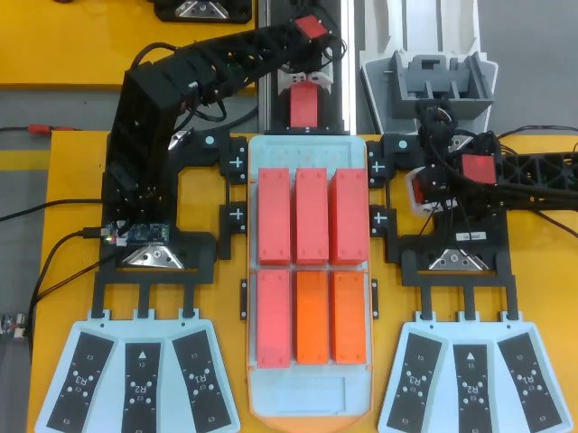</a>

- **날짜·시간:** 2026-11-27 00:37
- **모델 / 체크포인트:** F02 wristfix Best 012000
- **결과:** 운반 중 컨베이어 쪽 2층 컨테이너를 쳐서 넘어뜨림 → 사용자 정지(17초)
- **길이:** 22.9 s

### 13 · ACT 자율 · 1층 S03 — 집기 반복 실패

<a href="../assets/media/videos/13_B-F01-S03_ACT_fail_grasp_20261127-0001.mp4">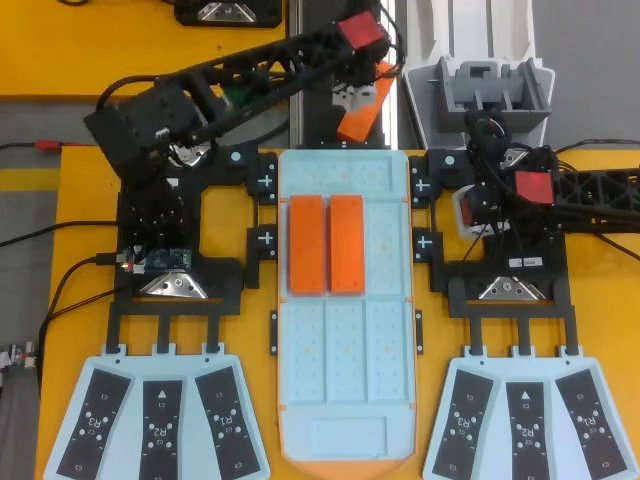</a>

- **날짜·시간:** 2026-11-27 00:01
- **모델 / 체크포인트:** F01 Best 012000 camwarp, step limit 5 시험
- **결과:** 집기를 반복하다 물체를 밀어냄, 30초 시간 종료 → step limit 3으로 되돌림
- **길이:** 36.1 s

- 사용 금지로 판정한 정면 카메라 보정(`bottomwarp`) 실행 2회는 위험 사례라 영상을 싣지 않았습니다. 기록은 [F02 S05 검증 문서](physical-validation-F02-S05.md)에 있습니다.

## 🟣 5. 텔레오퍼레이션 데이터 수집 (학습용 시연 — 자율 구동 아님)

사람이 리더 팔을 움직이면 팔로워 팔이 따라 움직이고, 그 영상과 관절값을 LeRobot 데이터셋으로 녹화했습니다. 아래는 품질 검사(QC)를 통과한 에피소드 가운데 처음부터 끝까지 깔끔하게 완료된 것을 골랐습니다. **A팔과 EX 분류 장소는 실물 ACT 자율 구동 기록이 없습니다**(A팔은 읽기 전용 점검만, EX는 오프라인 검증만 수행).

### 14 · A팔 · 1층 S03

<a href="../assets/media/videos/14_A-F01-S03_TELEOP_20261121_ep1.mp4">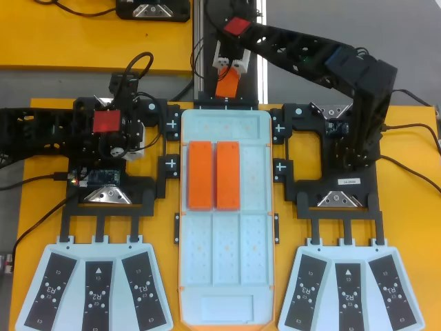</a>

- **녹화:** 2026-11-21, `pick_place_R_11_21_F01_S03` ep1 (QC 승인, A팔 F01 13k 모델 학습 데이터)
- **작업:** 컨베이어 컨테이너를 집어 트레이 1층 S03에 놓기
- **길이:** 16.7 s

### 15 · A팔 · 2층 S04

<a href="../assets/media/videos/15_A-F02-S04_TELEOP_20261121_ep7.mp4">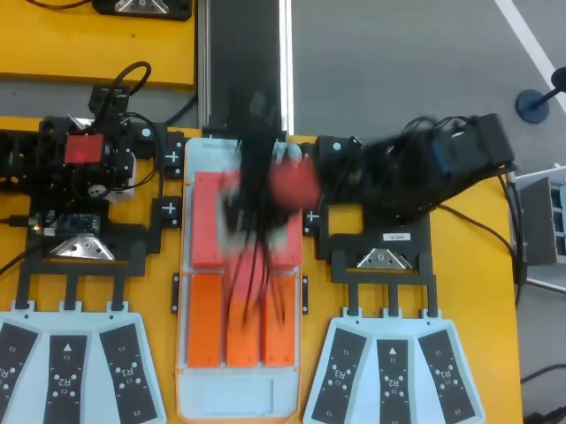</a>

- **녹화:** 2026-11-21, `pick_place_R_11_21_F02_S04` ep7 (QC 승인, A팔 F02 13k 모델 학습 데이터)
- **작업:** 컨베이어 컨테이너를 집어 2층 S04에 놓기
- **길이:** 14.2 s

### 16 · A팔 · 3층 S04

<a href="../assets/media/videos/16_A-F03-S04_TELEOP_20261124_ep9.mp4">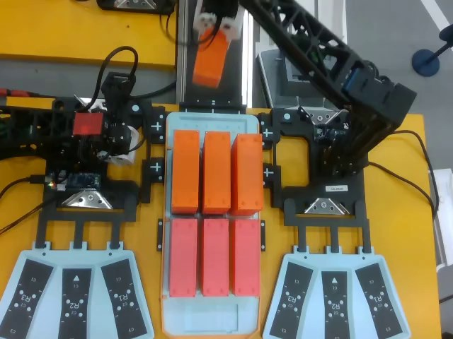</a>

- **녹화:** 2026-11-24, `pick_place_R_11_24_F03_S04` ep9 (QC 승인, A팔 F03 13k 모델 학습 데이터)
- **작업:** 컨베이어 컨테이너를 집어 3층 S04에 놓기
- **길이:** 20.7 s

### 17 · B팔 · EX 분류 장소

<a href="../assets/media/videos/17_B-EX-F01_TELEOP_20261121_ep1.mp4">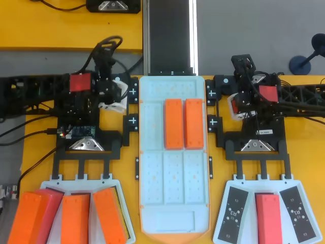</a>

- **녹화:** 2026-11-21, `pick_place_L_11_21_F01_EX` ep1 (QC 승인, B팔 EX 13k 모델 학습 데이터)
- **작업:** 트레이 1층의 컨테이너 3개를 하나씩 집어 팔 앞쪽 EX 분류 장소로 옮기기
- **길이:** 54.5 s

### 18 · A팔 · EX 분류 장소

<a href="../assets/media/videos/18_A-EX-F02_TELEOP_20261121_ep4.mp4">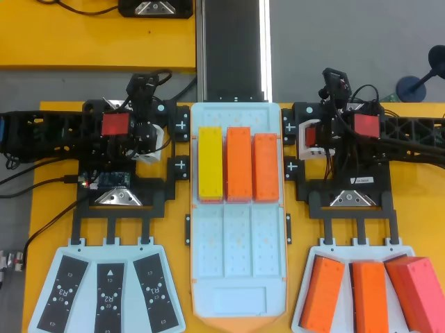</a>

- **녹화:** 2026-11-21, `pick_place_R_11_21_F02_EX` ep4 (QC 승인, A팔 EX 13k 모델 학습 데이터)
- **작업:** 트레이 2층의 컨테이너 3개를 하나씩 집어 팔 앞쪽 EX 분류 장소로 옮기기
- **길이:** 57.5 s

**양팔 동시 작업 영상은 없습니다.** 양팔 녹화(`bimanual/.../pick_place_v1`, 11-19)는 관절값만 기록됐고 영상이 없습니다.

## 추가 예정 — 휴대폰 촬영 전체 모습
로봇 전체 모습을 휴대폰으로 찍으면 `assets/media/videos/20_phone_overview_<YYYYMMDD>.mp4`, `assets/media/thumbs/20_phone_overview_<YYYYMMDD>.jpg` 이름으로 이 문서에 추가합니다.

## 공개 범위
- 공개: 위 탑뷰 영상 18개와 썸네일(실물 검증 13 + 텔레옵 시연 5)(개인정보 검사: 전 프레임 가장자리 침입 검사 + 1–2초 간격 육안 확인, 사람이 나오는 구간 제거, 소리·위치·기기 메타데이터 없음)
- 비공개 유지: 사이드·손목 카메라 영상, 실험 환경 사진, Hugging Face 링크
